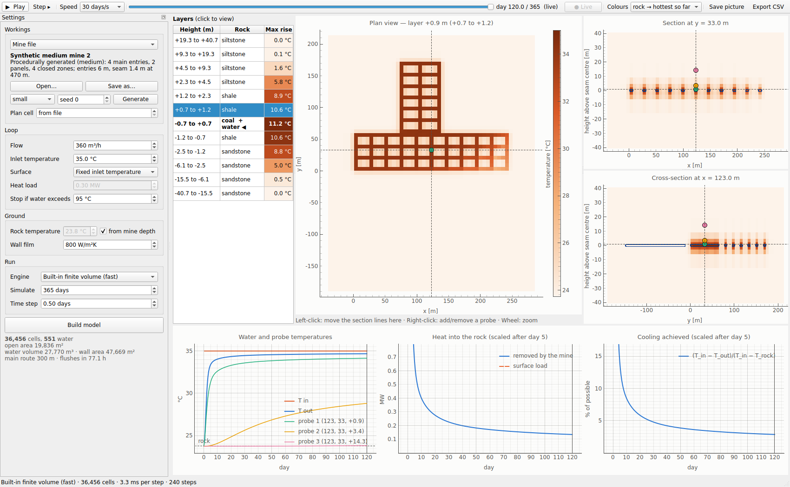
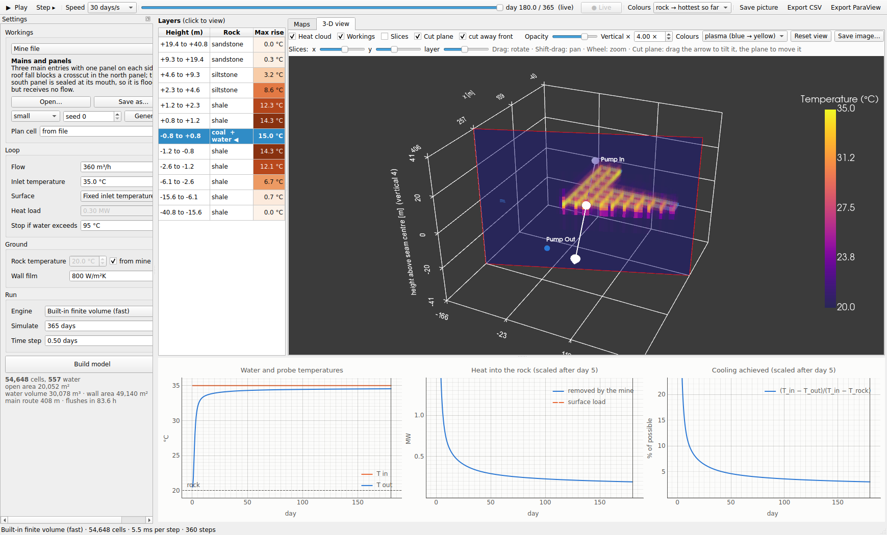
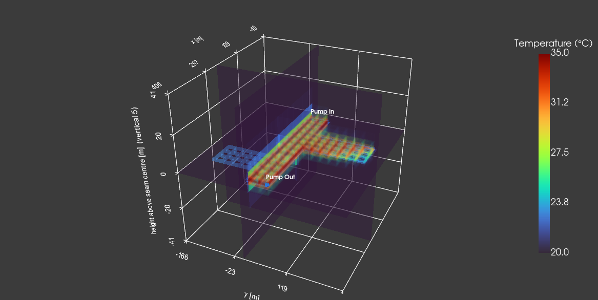

# Mine-water heat-sink sandbox (MODFLOW 6 + TESPy)

Hot water is pumped into a flooded mine, gives heat to the surrounding rock
as it flows through the workings, and is pumped back out. MODFLOW 6 (or a
built-in solver that matches it) models the mine: flow through the openings
and heat conduction into the rock. TESPy models the surface loop: pump,
SMR-side heat exchanger, and return pipe.

You can model a single drift, or a whole mine described in a **mine file**.
You can run it from scripts or watch it in the **live simulator**.



## Install

```bash
pip install -r requirements.txt
get-modflow :python        # downloads mf6 and libmf6 (only needed for the MODFLOW engine)
```

If `get-modflow` can't reach GitHub, download the zip for your OS from
https://github.com/MODFLOW-ORG/executables/releases/latest and copy `mf6`
and `libmf6` into `./bin/` (or set `MF6_EXE` / `MF6_LIB`). Without them,
everything still runs on the built-in engine.

**PySide6 must be below 6.12.** 6.12.0 has reference-counting bugs that
crash the app on exit with pyqtgraph. 6.10 and 6.11 are tested, and
`requirements.txt` pins this.

**GPU (optional).** With an NVIDIA GPU, install CuPy for your CUDA driver and the
built-in engine can solve on the GPU:

```bash
pip install "cupy-cuda12x[ctk]"     # CUDA 12.x driver (the [ctk] extra brings the CUDA libraries)
pip install "cupy-cuda13x[ctk]"     # or, with a CUDA 13 driver
python run_benchmark.py             # CPU vs GPU on this machine, and a check that they agree
```

Nothing else imports CuPy. Without it (or if the GPU fails its test kernel) everything
runs on the CPU and the app says why.

## Live simulator

```bash
python run_gui.py                                            # or: python -m mine_sandbox.gui
python run_gui.py --mine examples/mines/single_panel.json --build
```

- **Settings (left).** Choose a single drift (radial, 2-D slab or 3-D block grid) or a
  mine file. Open a file, or **Generate** a random one from a seed, and **Save as…**
  to keep it. Then set the flow, the inlet temperature or a fixed surface heat load
  (TESPy), the rock temperature (from the file's depth by default), the wall film,
  the engine, the **compute device**, the run length and the time step. Press **Build
  model**. The button turns bold when settings have changed and need a rebuild.
- **Compute.** *Auto* uses the GPU when one works and is faster for this model (it times
  both on the first step); *CPU* never touches the GPU; or pick a GPU by name. The panel
  under the Build button shows what was used and why.
- **Layers (left of the maps).** One row per horizontal layer, top to bottom, with
  its height band, rock, and how much it has warmed, shaded on the map's colour
  scale. The row with water is marked ◀. Click a row to show that layer in plan.
- **Maps.**
  - **Plan view:** the selected layer.
  - **Section:** a vertical slice along x.
  - **Cross-section:** a vertical slice along y.

  Water is outlined in blue. Pump In is ▲ and Pump Out is ▼. **Left-click** any map
  to move the other two slices through that point; clicking a height in a section
  selects that layer. **Right-click** pins a temperature probe (up to 6) and
  right-clicking it again removes it. The mouse wheel zooms.
- **Charts (bottom).**
  - Loop temperatures and probe temperatures.
  - Heat removed by the mine against the surface load.
  - Cooling achieved, (T_in − T_out)/(T_in − T_rock).

  The heat and cooling charts are scaled from day 5, after the cold water that
  filled the workings has flushed out.
- **Playback (top).**
  - Play/Pause with Space, Step with →.
  - Speed in simulated days per second, or **max** (as fast as the solver goes).
  - The **scrubber** replays any earlier moment (so does clicking a chart). **● Live**
    returns to the running edge.
  - The colour scale runs from rock temperature to the hottest temperature so far,
    or to this frame only.
  - **Save picture** and **Export CSV** (the loop series, plus probes).

### 3-D view

The **3-D view** tab shows the model as an object you can turn and cut open:



- **Heat cloud:** volume rendering of the temperature. Undisturbed rock is invisible,
  and the cloud grows more opaque the more the rock has warmed.
- **Workings:** the water-filled openings in translucent blue, with Pump In and Pump
  Out marked.
- **Slices:** three sheets (a plan layer, a section and a cross-section). They stay
  in sync with the Maps tab and the layer list, and the sliders here move them too.
- **Cut plane:** drag the plane to move it and the arrow to tilt it. Its face shows
  the exact cross-section of the model. With *cut away front* checked, everything
  between you and the plane is hidden, so you look into the cut.
- **Display controls:**
  - Vertical exaggeration (the axes keep their true metres).
  - Opacity.
  - Colours: plasma by default; heat (as the maps), viridis, or turbo (a rainbow,
    like most geological viewers).
  - Reset view and Save image.
- **Export ParaView…** (toolbar) writes every stored frame as `.vtr` files plus a
  `.pvd` time series. In ParaView, open the `.pvd` and press play for full volume
  rendering, clipping, and contouring.



The 3-D view needs `pyvista` and `pyvistaqt`, plus an OpenGL display. It's
available for the 3-D block grid and for mines; the radial and 2-D slab grids
have no plan width to show.

### Speed: a separate process, the GPU, and progress bars

- **The simulation runs in its own process**, not a thread. (Python threads take turns
  on one interpreter lock, so a busy solver thread made the window stutter and both ran
  slower.) The window only draws what the process sends back about 30 times a second,
  and it spaces redraws out by itself if the machine can't keep up, so it stays
  responsive however large the model is.
- **Progress bar (status bar, bottom right).** While building it shows each stage
  (grid, rock properties, flow, heat matrix, solver, surface loop) with the time elapsed
  and an estimate of the time left. The estimate corrects itself as stages finish and
  learns how fast your machine is across builds. **Cancel** stops a build (the process
  is restarted). While running it shows the day reached, simulated days per second,
  milliseconds per step, elapsed time and ETA, and *solver-limited* if the chosen speed
  is more than the solver can deliver.
- **If the GPU fails mid-run** (driver reset, out of memory), the run carries on on the
  CPU from the same step with an amber banner. If checking for a GPU crashes the
  process, it restarts on the CPU only. If the process dies, it is restarted and you
  are told.
- `python run_gui.py --backend thread` runs the old in-process worker (for debugging);
  `--device cpu` starts with the CPU selected. `MINE_SANDBOX_DEVICE=cpu` hides the GPU
  everywhere.

If the loop water passes the stop temperature, the run halts with a red
banner: the mine cannot reject that heat load.

## Mine files

A mine file is JSON (or YAML, if PyYAML is installed). It describes the mine;
the 3-D model is generated from it procedurally:

```json
{
  "format": "mine-sandbox/mine", "version": 1,
  "name": "Single panel", "description": "...", "source": "where the data came from",
  "seam":       {"thickness_m": 1.8, "depth_m": 250, "rock": "coal"},
  "strata":     {"background": "shale",
                 "beds": [{"z_bottom_m": 4.0, "z_top_m": 1e9, "rock": "sandstone"}]},
  "conditions": {"flow_m3_h": 360, "T_in_C": 35, "T_rock_C": null,
                 "T_surface_C": 12, "gradient_C_per_km": 25, "h_film_W_m2K": 800, "water_porosity": 1.0},
  "pumps":      {"inlet_xy": [3, 3], "outlet_xy": null},
  "grid":       {"plan_cell_m": 6, "margin_m": 40, "margin_cells": 4, "layers_above": 6,
                 "layers_below": 5, "extent_above_m": 40, "extent_below_m": 40,
                 "first_layer_m": 0.5, "bridge_diagonals": true},
  "layout":     {"type": "room_and_pillar", "n_entries": 5, "n_pillars_along": 10,
                 "entry_width_m": 6, "pillar_length_m": 18, "pillar_width_m": 18}
}
```

- **Coordinates.** Metres, in the mine's own plan frame. Strata heights are measured
  from the seam centre (+ up).
- **Rocks.** Names from `materials.ROCKS` (sandstone, shale, siltstone, limestone,
  coal, granite, basalt), or a custom `{"name", "k", "rho", "cp"}`.
- **Rock temperature.** `T_rock_C: null` derives it from `depth_m` and the geothermal
  gradient. Give one or the other.
- **Pumps.** `null` pumps go at the two open points farthest apart through the
  workings.
- **Only `name` and `layout` are required.** Everything else has defaults.
- **Reading is strict.** A typo such as `"thicknes_m"`, a wrong type, or an unknown
  rock or layout fails with a message naming the exact place in the file.

### Layout types

| `type` | Use it for | Fields |
|---|---|---|
| `room_and_pillar` | a parametric panel (summary numbers per mine) | `origin`, `rotation_deg`, `n_entries`, `n_pillars_along`, `entry_width_m`, `crosscut_width_m`, `pillar_length_m`, `pillar_width_m` |
| `polylines` | tunnels traced off a mine map | `drifts: [{"points": [[x, y], ...], "width_m": w}, ...]` |
| `polygon` | any traced outline | `points` |
| `rectangle` | a box (often a closed zone) | `origin`, `length_m`, `width_m`, `rotation_deg` |
| `composite` | a whole mine: union of `parts` minus `holes` (roof falls, seals, barriers) | `parts`, `holes` |

Examples in `examples/mines/`:

- `single_panel.json`: parametric.
- `traced_drifts.json`: traced centrelines, including diagonal tunnels.
- `mains_and_panels.json`: composite, with a roof fall and a sealed panel that stays
  flooded but gets no flow.
- `synthetic_*.json`: generated.

**Grid notes.**

- Openings are captured where a plan cell's centre falls inside them, so keep
  `plan_cell_m` no coarser than the narrowest opening (you get a warning if it is).
- `bridge_diagonals` keeps angled tunnels continuous on the square grid.
- All workings sit in one seam layer. Multiple seams are a natural extension in
  `MineGrid`.

### Generating mines

```bash
python -m mine_sandbox.mines --count 10 --seed 1 --size medium --out mines/
```

Each seed gives a reproducible room-and-pillar mine:

- main entries, with panels off both sides
- roof falls blocking crosscuts
- sometimes a sealed panel
- layered strata
- seam depth, which sets the rock temperature

Dimensions are drawn from typical Appalachian ranges. Sizes: `small` ≈ 10–30k
cells, `medium` ≈ 30–60k, `large` ≈ 100k+.

### Comparing mines

```bash
python run_mines.py examples/mines                    # same test on every file -> figures/mines/
python run_mines.py mines/ --load-mw 0.5 --days 730   # closed loop with a TESPy heat load
python run_mines.py mines/ --jobs 4                   # four mines at once, one process each
python run_mines.py mines/ --device auto              # on the GPU when it helps
```

This writes `comparison.csv` and `comparison.png` with each mine's heat removed,
cooling achieved, and heat per m² of wall over time.

## Scripts and API

```python
from mine_sandbox import *
from mine_sandbox.mines import load_mine, scenario_from_mine

sc = scenario_from_mine(load_mine("examples/mines/mains_and_panels.json"), sim_days=365)
r = run_coupled(sc, model_factory=FiniteVolumeModel)          # or the MODFLOW default
print(r.summary())

sc = make_scenario(length_m=800, width_m=6, height_m=2, diameter_m=None,
                   grid=StructuredDriftGrid.block_3d())       # a single drift
r = run_coupled(sc, TespySurfaceLoop.for_scenario(sc, FixedHeatLoad(0.3e6)))
```

```bash
python run_sandbox.py              # single-drift sweeps over flow, T_in, size, rock (+ --grid 3d, --layered)
python run_benchmark.py            # build and step times on the CPU and GPU
python -m pytest -q                # 164 tests, ~1 min
```

```python
m = FiniteVolumeModel(problem, device="auto")    # or "cpu", "cuda:0"; progress=callable(stage)
print(m.device.label, m.solver_description, m.fallback_reason)
```

## Engines

| Engine | Use | Speed |
|---|---|---|
| `fv`: built-in finite volume (`FiniteVolumeModel`) | the live simulator, big mines, sweeps | 2–18 ms per step on 10–130k cells (CPU); builds in well under a second |
| `fv` on an NVIDIA GPU (CuPy) | large mines, fine grids | see `run_benchmark.py` |
| `mf6`: MODFLOW 6 via libmf6 (`Mf6ApiSession`) | the reference numbers | ~10–50× slower, CPU only |

They solve the same discretisation and agree to about 1e-4 °C. The small remaining
gap is MODFLOW's numerical leakage through the (nearly impermeable) rock, and it
shrinks as the rock is made less permeable.

**Solvers.** Small grids (≤ 3,000 cells) LU-factorise the heat matrix once. Larger ones
use BiCGSTAB with a preconditioner built from the physics (`compute/block_solver.py`):
the water network is solved exactly (it is small, and advection carries heat across
tens of cells per step, which defeats local methods), and the rock, whose rows are
dominated by heat capacity, gets Jacobi. Warm-started from the last step it converges
in 2–5 iterations, needs no large factorisation (builds are ~10× faster than the old
incomplete-LU solver), and is all mat-vecs and vector updates, so the same code runs on
the GPU. `solver="iterative"` (ILU) and `"direct"` are still available.

## Architecture

Each layer depends only on the layers above it.

```
materials, geometry, geology   what things are made of / shaped like / where rock is
grids/                         Grid -> CellGraph (cells, faces, inlet/outlet, route, voxel lattice)
mines/                         MineSpec, layouts, mine files, generator, MineGrid (a Grid)
scenario, assembly             what to simulate -> per-cell properties + wall film
model, surface/                the two interfaces the coupler talks to (ThermalModel, InletController)
fv, mf6/                       ThermalModel implementations (only mf6/ imports flopy/modflowapi)
engines                        registry of ThermalModels for UIs and scripts
simulation                     CoupledStepper (one closed-loop step), run_coupled, run_fixed_inlet
results, energy, plotting      grid-agnostic results and figures
compute/                       where the solve runs: device detection, CPU/GPU array backends,
                               block-preconditioned BiCGSTAB (the only code that may import CuPy)
live/                          Qt-free live session: LiveConfig, staged build with progress,
                               History, SimulationSession, SimulationProcess (a session in its
                               own process, driven by commands)
viz3d/                         Qt-free 3-D datasets (VolumeData) and ParaView export (needs pyvista)
gui/                           PySide6 widgets: process worker, settings, layer selector, slice views,
                               charts, VolumeView (3-D tab), progress bar
```

What makes this extensible:

- **One description for every grid.** Everything downstream reads a `CellGraph`
  (plain data) plus its `Lattice` (which voxel holds which cell). The engines,
  results, plots, batch scripts, and every GUI view work unchanged on the radial
  grid, the 2-D slab, the 3-D block, or a whole mine.
- **The same loop everywhere.** `CoupledStepper` is the closed loop used by
  `run_coupled`, the batch scripts, and the GUI timer. The live view and the
  scripts cannot disagree.
- **New behaviour plugs in rather than requiring edits:**

| To add | Implement | Register with |
|---|---|---|
| a grid | `Grid` | `ALL_GRIDS` in `tests/conftest.py` (gets the contract tests) |
| a layout type | `Layout` | `@register_layout("name")` (the file reader picks it up) |
| a drift shape | `CrossSection` | |
| a geology | `Geology` | |
| a surface mode | `LoadMode` or any `InletController` | |
| a solver | `ThermalModel` | `register_engine` (appears in the GUI) |
| a linear solver for the fv engine | `LinearSolver` | `make_solver` |
| a compute device | `ArrayBackend` | `make_backend` / `detect_devices` |

## Checks (`python -m pytest -q`)

- **Grid contract.** Every grid, including a mine, is checked for a valid graph, a
  connected route, the far field on the outer boundary, lattice views, and the rock
  profile.
- **Regression.** The radial grid reproduces the original single-file model's results exactly.
- **Energy conservation.** For every grid, heat out of the water equals heat stored.
- **Independent benchmarks.** The radial, slab, and 3-D grids are compared against the
  numpy reference solutions in `validation/`.
- **Engine agreement.** The built-in engine is checked against MODFLOW on the radial,
  3-D and mine grids. The direct and iterative solvers agree, and the flow reaches
  Pump Out with none through rock.
- **Mine files.** Every example loads and builds, saving and loading round-trips for
  JSON and YAML, and bad files give precise errors. The generator is reproducible and
  its mines are connected; bridging and pump placement are tested.
- **Live and GUI.** History decimation and thread safety, the session's end and
  runaway handling, and a headless GUI covering building, layer selection, clicks,
  probes, replay, CSV export, error banners, and a real live run in the simulation process.
- **Process and progress.** Batches from the simulation process rebuild exactly the
  History a direct run would; build stages arrive in order with a progress fraction that
  never goes backwards; build errors come back as messages; cancelling restarts the process.
- **Compute.** The block solver matches refined LU to 1e-8 °C and the direct solver over
  whole runs; the GPU code path (run on numpy, and through CupyBackend with numpy standing in
  for CuPy) matches the CPU; a GPU that fails to start, or dies mid-run, falls back to the
  CPU without losing a step; *Auto* keeps the faster device.
- **3-D.**
  - The 3-D grids carry the field exactly, exaggeration scales only height, and cuts
    and slices show the heat.
  - The ParaView series reads back.
  - An end-to-end test opens the 3-D tab on a (virtual) display, cuts the model,
    turns on slices, changes exaggeration and colours while simulating, checks the
    sliders move the maps, and checks the image isn't blank.

## Scope

- **Conduction only in the rock.** There is no regional groundwater flow; rock is
  effectively impermeable.
- **Mine water flows through the open workings** as a connected network. Sealed
  areas hold still water.
- **One seam horizon per mine.**
- **No open basin or ground-surface heat loss.**
- **The far-field boundary** sits about 40 m from the workings by default. For runs
  much longer than a few years, increase `extent_*_m` and `margin_m` so the heat
  front doesn't reach it. Heat travels roughly 11 m per year in sandstone.
